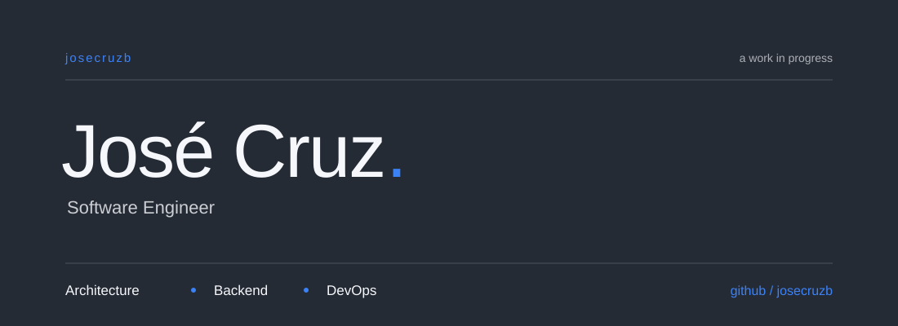

## About


```js
const jose = {
  role: "Software Engineer",
  focus: ["Architecture", "Backend", "DevOps"],
  exploring: "UI design",
};
```

> “Nothing happened.”
>
> — Roronoa Zoro · *One Piece*

<br clear="both" />

---

Building. Learning. Adjusting.
